# 🚢 PortSim – Ship Docking at the Port Simulation

<p align="center">
  
  
  
  
  
</p>

<p align="center">
  <strong>A fully interactive 3D OpenGL simulation of a modern seaport</strong><br>
  Control ships • Operate cranes • Load containers • Manage trucks & warehouse
</p>

<p align="center">
  <a href="#-features">Features</a> •
  <a href="#-screenshots">Screenshots</a> •
  <a href="#-controls">Controls</a> •
  <a href="#-build--run">Build & Run</a> •
  <a href="#-project-structure">Structure</a>
</p>

---

## ✨ Features

| Feature | Description |
|---------|-------------|
| 🚢 **Dual Ship Control** | Select and navigate two independent cargo ships with realistic hull, deck, bridge, chimney & smoke particles |
| ⚓ **Automatic Anchoring** | Ships automatically dock and drop ropes when they reach the pier |
| 🏗️ **Interactive Crane** | Full crane cycle: rotate → lower hook → grab container → lift → return |
| 📦 **Container Handling** | 20 containers per ship (5×4 grid) + warehouse stacks. Load containers onto trucks |
| 🚛 **Vehicle Fleet** | 5 controllable trucks + 2 cars with independent movement |
| 🏭 **Warehouse** | Interactive gate (open/close) with interior container storage visible through windows |
| 🌊 **Dynamic Water** | Animated waves using multi-frequency sine functions + ambient wave sound |
| 👷 **Living Port** | 8 workers walking randomly across the pier |
| 🎥 **Free Camera** | Orbit, zoom in/out, and look around the entire scene |
| 🔊 **Sound Effects** | Wave ambient, ship engines, crane movement, and door sounds |

---

## 🖼️ Screenshots

### Ship Navigation

| Forward (`W`) | Left (`A`) |
|:-------------:|:----------:|
| 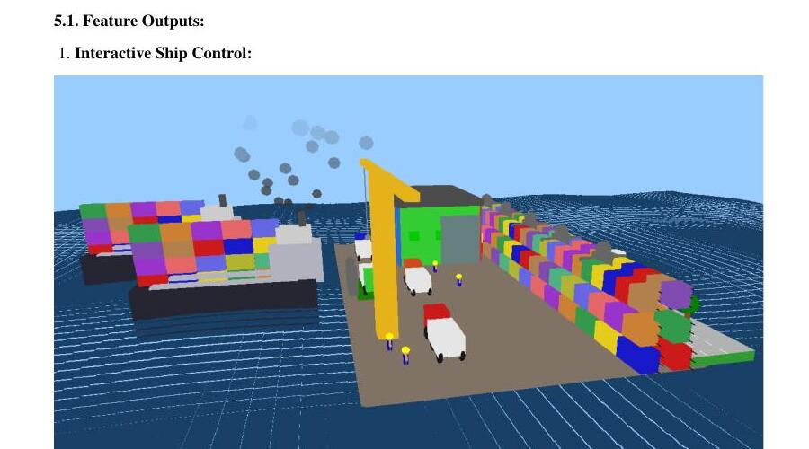 | 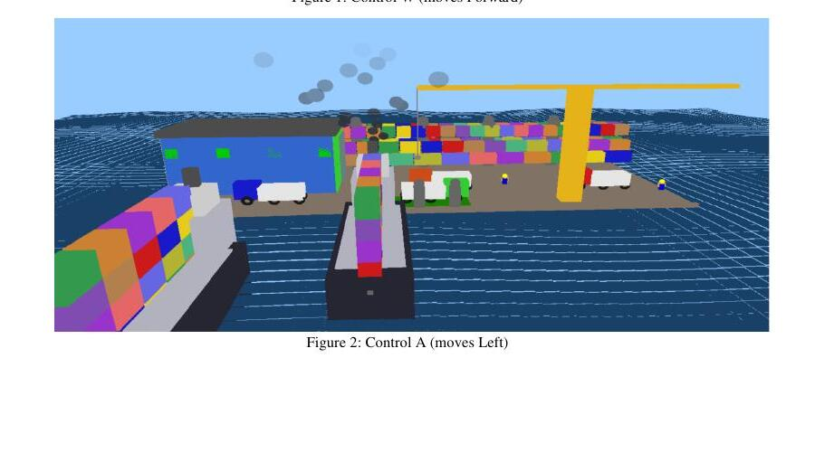 |

| Right (`S`) | Backward (`Z`) |
|:-----------:|:--------------:|
| 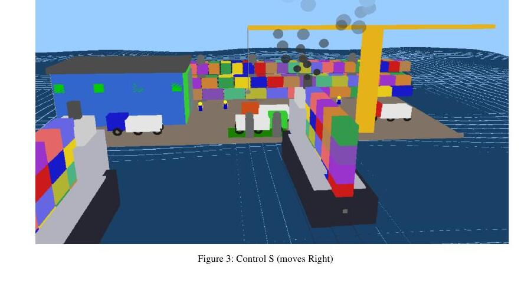 | 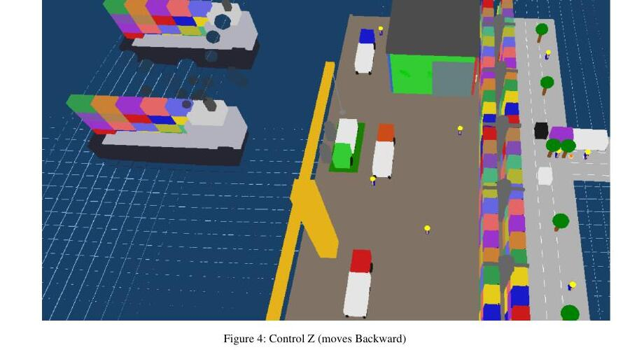 |

### Docking & Anchoring

| Anchored at Pier | Overview |
|:----------------:|:--------:|
| 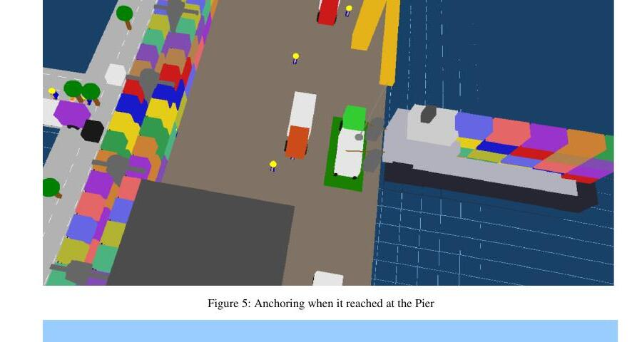 | 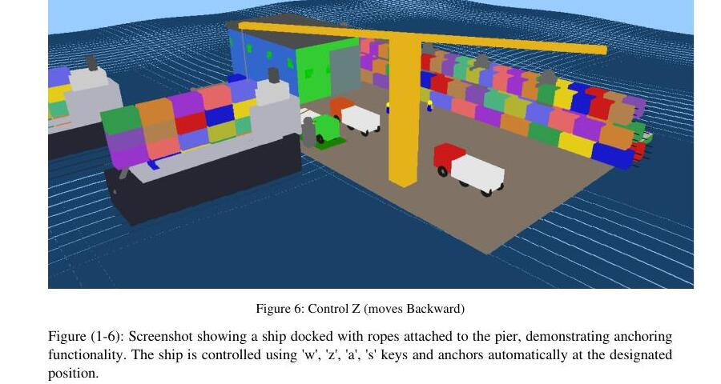 |

### Crane Operations

| Approaching Ship | Lifting Container |
|:----------------:|:-----------------:|
| 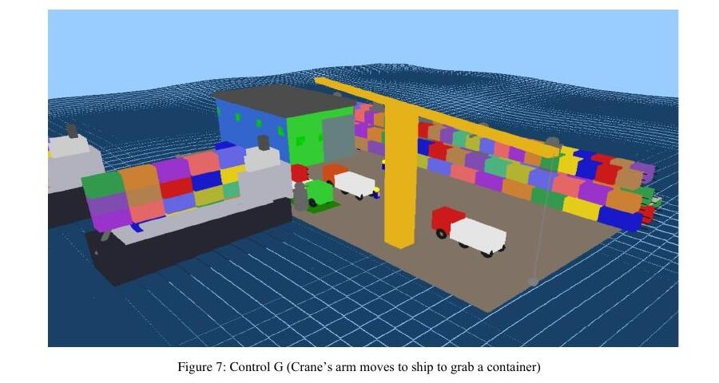 | 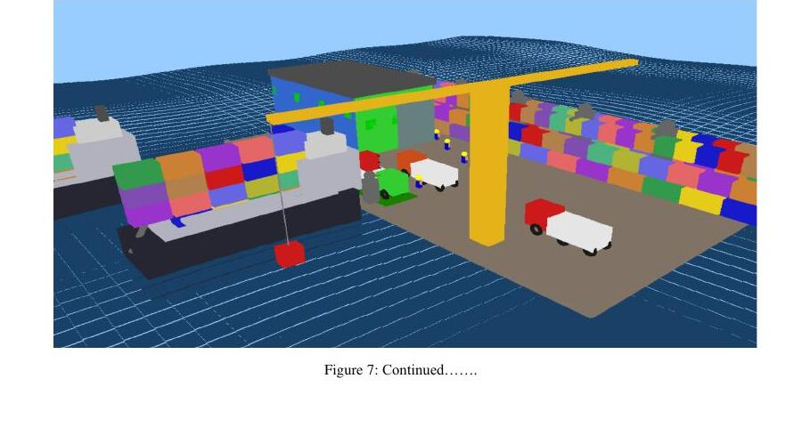 |

| Crane Working | Container Stacks |
|:-------------:|:----------------:|
| 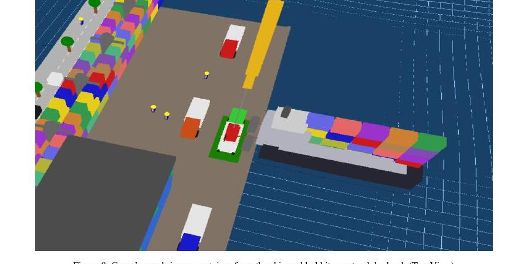 | 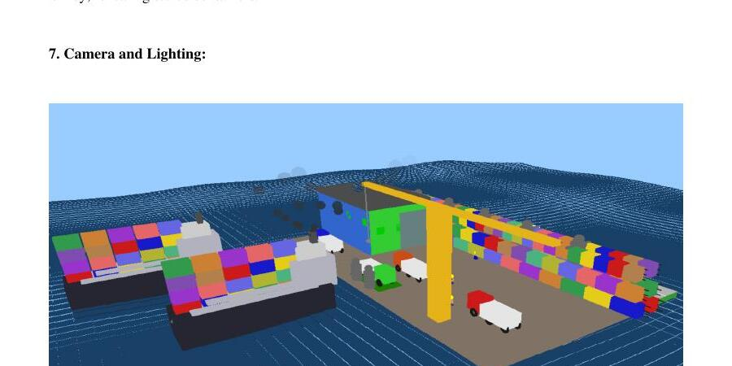 |

### Port Logistics

| Warehouse Gate | Trucks Loading |
|:--------------:|:--------------:|
| 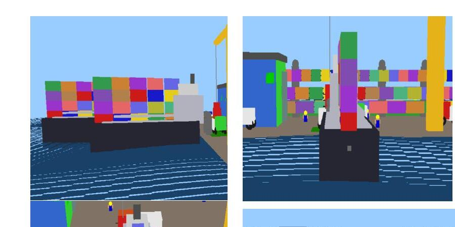 | 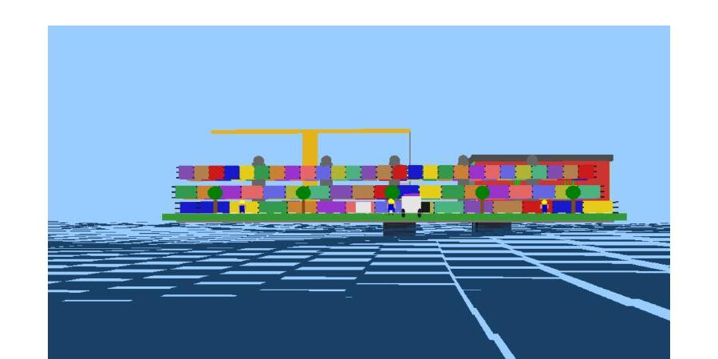 |

| Full Port View | Detail View |
|:--------------:|:-----------:|
| 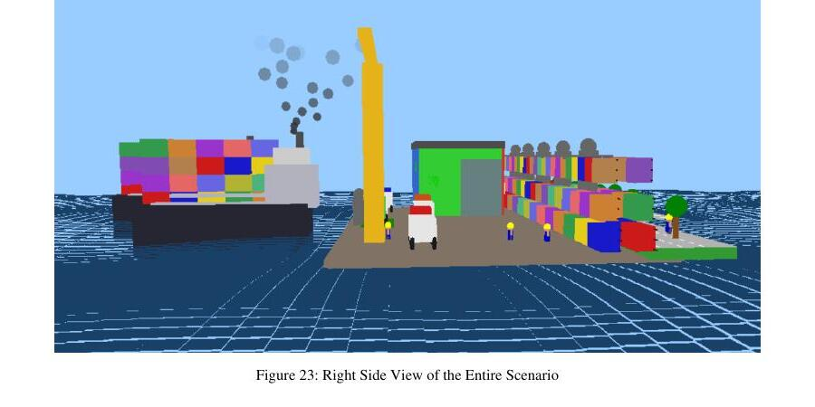 |  |

| Workers & Activity | Final Scene |
|:------------------:|:-----------:|
|  | 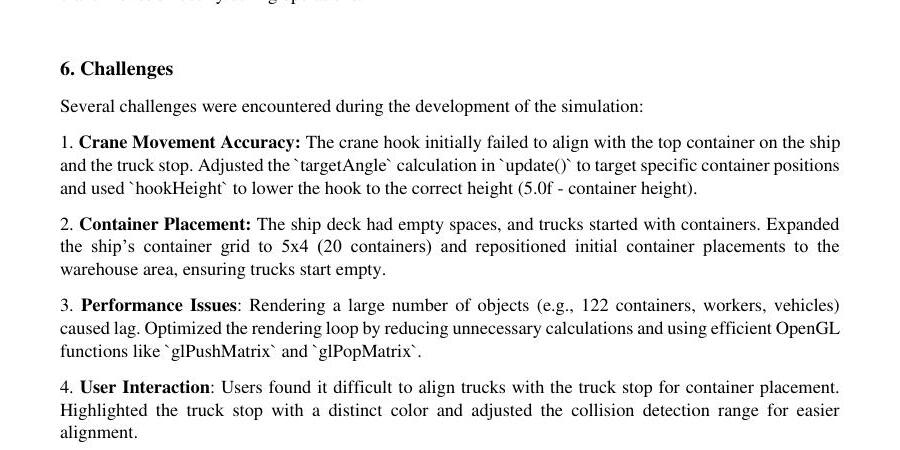 |

> More screenshots available in [`docs/screenshots/`](docs/screenshots/)

---

## 🎮 Controls

### Camera
| Key | Action |
|-----|--------|
| `←` `→` `↑` `↓` | Rotate camera |
| `+` / `-` | Zoom in / Zoom out |

### Ships (first click a ship to select it)
| Key | Action |
|-----|--------|
| `W` | Move forward |
| `Z` | Move backward |
| `A` | Move left |
| `S` | Move right |

### Crane
| Key | Action |
|-----|--------|
| `G` | Start crane operation (grab next container) |
| `H` | Release container onto truck |

### Trucks (click a truck to select)
| Key | Action |
|-----|--------|
| `I` | Move forward (X+) |
| `M` | Move backward (X−) |
| `J` | Move left (Z−) |
| `K` | Move right (Z+) |

### Cars
| Key | Action |
|-----|--------|
| `1` `2` | Car 1 forward / backward |
| `3` `4` | Car 1 left / right |
| `5` `6` | Car 2 forward / backward |
| `7` `8` | Car 2 left / right |

### Warehouse & Misc
| Key | Action |
|-----|--------|
| `O` | Toggle warehouse gate |
| `D` | Debug print state |
| `Esc` | Exit |

---

## 🛠️ Build & Run

### Requirements
- Windows (uses `winmm.lib` for sound)
- C++ compiler (MinGW / MSVC)
- FreeGLUT or GLUT
- OpenGL

### Compile (MinGW example)

```bash
g++ -o PortSim.exe src/main.cpp -lfreeglut -lopengl32 -lglu32 -lwinmm
```

### Run

```bash
./PortSim.exe
```

> **Note**: Place the sound files (`waves.wav`, `ship_engine.wav`, `crane_movement.wav`, `doorsound.wav`) in the same directory as the executable for audio.

---

## 📁 Project Structure

```
PortSim/
├── src/
│   └── main.cpp              # Complete simulation source (single file)
├── docs/
│   ├── screenshots/          # 19+ high-quality screenshots
│   └── Project Report.pdf    # Full academic project report
├── assets/                   # (optional) place .wav sound files here
├── README.md
├── LICENSE
└── .gitignore
```

---

## 🧠 Technical Highlights

- **Rendering**: Immediate-mode OpenGL + GLUT primitives (cubes, spheres, toruses)
- **Lighting**: Ambient + Diffuse with color material
- **Animation**: Timer-driven (`glutTimerFunc` @ 50 ms) for waves, smoke, crane, workers, doors
- **Smoke System**: Particle system with lifetime, alpha fading & size growth
- **Picking**: Ray-casting mouse selection for ships and trucks
- **Physics-like**: Automatic anchoring detection, rope rendering, container state machine

---

## 📄 Academic Info

- **Course**: Computer Graphics Lab (CSE-4110)
- **University**: University of Barishal
- **Submitted by**: Md. Asad Mondall (20CSE006) & Soheb Hossen (20CSE019)
- **Supervisor**: Dr. Md Manjur Ahmed
- **Date**: May 2025

Full report available in [`docs/Project Report.pdf`](docs/Project%20Report.pdf)

---

## 📜 License

This project is released under the **MIT License**. See [LICENSE](LICENSE) for details.

---

<p align="center">
  Made with ❤️ for Computer Graphics students<br>
  <strong>PortSim</strong> — Experience the life of a busy seaport in 3D
</p>
